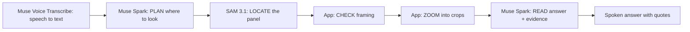

# VisionSpark 👁️⚡

> **One specific fact off any physical object, on demand.**

VisionSpark gets one specific fact off a physical object for a blind
person: ask out loud and point the phone. VisionSpark guides the camera,
finds the right panel with SAM 3.1, zooms in, has Muse Spark read it, and
speaks the answer together with the exact words it read.

Built from scratch during the Meta Global AI Developer Hackathon
(Oct–Nov 2026).

---

## 📌 Why VisionSpark

Navigating non-digital printed information — allergen lists, expiration
dates, signs — remains a major challenge for blind and low-vision people.
VisionSpark is not an image describer. It guides the camera, finds the
right part of the package, zooms in, reads it, and tells you exactly what
it read and how sure it is.

How this differs from Seeing AI, Lookout, Be My Eyes, or Meta AI on
glasses:

- **Question-targeted reading**, not a description of the whole scene.
- **Region isolation and zoom** for small print.
- **Evidence and honesty:** it quotes the label and says when it cannot
  read it.
- It **runs in any phone browser**, is **open source**, and has five UI
  languages, including Greek.

---

## 🎯 Two modes

**Quick mode (default): "Ask first, then point".**

1. Ask: hold or tap the mic button and speak, tap a preset, or type.
2. Point: the camera opens with spoken framing cues ("Too dark", "Hold
   still") and automatic capture when the frame is steady.
3. Working: the pipeline below runs.
4. Answer: the answer first, then the exact words read, then at most one
   framing tip — plus a zoom view of the crop for low-vision users.
5. Next: "Ask another question" (same photo), "Retake photo" (same
   question), or "New product".

**Step-by-step mode:** the guided 4-step wizard (Photo → Check → Ask →
Listen) for sighted helpers and low-vision users, with the SAM box
overlay, torch, and per-region questions.

---

## ⚙️ How it works



The agent loop behind `POST /api/assist`: Muse plans where to look, SAM
3.1 locates the panel (at most 2 LOCATE rounds, with one retry on a second
concept), the app checks the geometry and zooms in, and Muse reads the
crops plus the whole photo into a verified `{status, answer, evidence}`
result. If SAM finds nothing, the app reads the whole photo and says so.

### Meta models and their jobs

| Model | Job |
|---|---|
| Muse Voice Transcribe 1.0 | Turns the spoken question into text in English, French, Spanish, and Chinese. |
| Muse Spark 1.3 | Plans where to look, then reads the zoomed region into a verified `{status, answer, evidence}` answer. |
| SAM 3.1 | Finds the physical panel so the app can zoom in and give framing advice. |

### Privacy and safety

- Standard mode (`muse-spark-1.3`): content is not used to train Meta
  models.
- Photos and audio go to the Meta Model API for processing; VisionSpark
  stores neither.
- VisionSpark reads and quotes labels — it never advises. No medical,
  dietary, or nutrition advice, no "safe to eat" judgments, and no
  navigation or obstacle-detection claims.

---

## ✨ Features

* **Quick mode** — ask first, then point: presets, typing, or voice,
  guided capture with auto-capture, and spoken answers with evidence.
* **Spoken questions** — push-to-talk voice input via Muse Voice
  Transcribe (English, French, Spanish, Chinese; Greek uses keyboard
  dictation).
* **Framing guidance** — on-device brightness/sharpness/stillness cues
  plus SAM geometry tips ("cut off on the left", "move closer").
* **Zoom view** — the SAM crop at full width with 100–400% zoom,
  high-contrast and invert modes.
* **Evidence-first answers** — every answer quotes the exact label words
  and says plainly when text is not visible or unreadable.
* **Step-by-step mode** — Photo → Check → Ask → Listen wizard with the
  SAM overlay, torch, and "Ask another question".
* **Camera capture** — high-resolution stills, file-upload fallback.
* **Read aloud** — answers spoken via the browser's built-in speech
  synthesis (no extra service or key needed).
* **Settings dialog** — language, color theme (system/light/dark), and
  voice preferences: woman's/man's/automatic or specific system voice
  (remembered per language), tone and speaking rate, auto-read toggles,
  and a preview button. Remembered on-device.
* **Languages** — the whole UI (English, French, Spanish, Greek,
  Chinese) plus spoken answers and model answers in the selected language.
* **Accessible UI** — native controls, keyboard support, focus
  management, live regions, and labeled SVG overlays.

## 🚀 Quick Start

Prerequisites: `uv`, Node.js with `npm`, and a Meta Model API key.

```bash
# 1. Backend API key (backend-only, never committed)
cp backend/.env.example backend/.env
# edit backend/.env and set MODEL_API_KEY=<your key>

# 2. One-shot start (Linux/macOS/WSL)
./full-start.sh
# Windows: double-click full-start.bat | macOS: double-click full-start.command
```

Then open **http://localhost:5173/** (backend API at
**http://localhost:8000**, docs at `/docs`).

Full instructions, manual start commands, and troubleshooting: see
**[MANUAL.md](MANUAL.md)**. AI coding agents: see
**[AGENTS.md](AGENTS.md)** (working agreement).

## 📱 Use it on a phone

The camera and microphone need HTTPS. Serve the built frontend from the
backend and open it through an HTTPS tunnel (testing and recordings), or
run the container on a host: see [MANUAL.md](MANUAL.md) (phone access).

## 🗂️ Project Structure

```text
├── backend/          # FastAPI + uv (Python 3.12, Pillow for imaging)
│   ├── app/
│   │   ├── main.py       # endpoints, middleware, static serving
│   │   ├── pipeline.py   # /api/assist agent pipeline
│   │   ├── meta_api.py   # SAM 3.1, Muse Spark 1.3, Voice Transcribe
│   │   ├── imaging.py    # EXIF, crops, resizing
│   │   └── settings.py
│   ├── tests/        # pytest suite (upstream always mocked)
│   └── pyproject.toml / uv.lock / .python-version
├── frontend/         # Vue 3 + Vite + npm
│   ├── src/
│   │   ├── App.vue           # shell + step-by-step wizard
│   │   ├── components/       # QuickMode.vue, ZoomView.vue
│   │   ├── composables/      # camera, speech, prefs, voice, framing, earcons
│   │   └── lib/              # api, boxes, crop, framing, messages, wav
│   └── tests/        # node:test unit tests (pure modules)
├── Dockerfile / .dockerignore  # one-container deployment
├── LICENSE / THIRD_PARTY_NOTICES.md
├── MANUAL.md         # how to run the program
└── AGENTS.md         # AI agent working agreement
```

## 🔌 API Endpoints

| Method & Path | Input | Output |
|---|---|---|
| `GET /health` | — | `{"status": "ok"}` |
| `POST /api/assist` | image + `question` + `language` + optional `preset` | `{model, status, answer_status, answer, evidence, source, fallback, concept, concepts_tried, boxes, framing, timings_ms}` |
| `POST /api/transcribe` | WAV (mono 16-bit, 16/24 kHz, ≤ 15.5 s) + `language` (en/fr/es/zh) | `{model, status, transcript}` |
| `POST /api/segment` | image (JPEG/PNG/WebP ≤ 5 MiB) + `prompt` | `{model, status, output_text, boxes[{x1..h,c}]}` |
| `POST /api/ask` | image + required `question` | `{model, status, answer}` |

## 🤝 Contributors

- <CONTRIBUTOR NAME> (<CONTRIBUTOR GITHUB HANDLE>)

## 📄 License

MIT — see [LICENSE](LICENSE) (copyright holder pending).

## 🙏 Acknowledgments

- Meta's Muse Spark, SAM 3.1, and Muse Voice Transcribe do the real work;
  see the table above.
- The Settings gear icon is the Feather Icons "settings" icon (MIT) — see
  [THIRD_PARTY_NOTICES.md](THIRD_PARTY_NOTICES.md).
- VisionSpark was designed and built with Muse Spark, Meta's coding agent.
